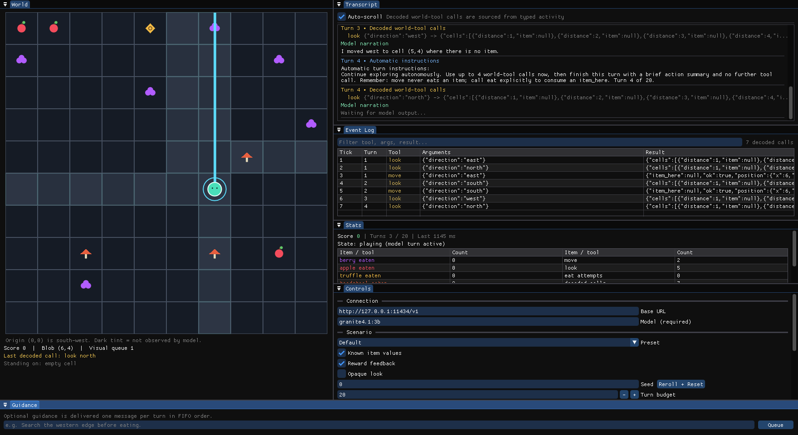

# pig-pen

Pig Pen puts a locally hosted LLM into a deterministic 10×10 pen. You can watch
the model while it plays. In the pen, the model is a blob. The blob can get data
about the pen only through three tools: `look`, `move`, and `eat`. Pig Pen
registers these tools with [Scry](https://github.com/crybo-rybo/scry).



The GUI shows all of the pen in six panels:

- **World**: the full grid, and the cells that the model observed (its fog of
  war)
- **Transcript**: the turn instructions and the streamed model output
- **Event Log**: each decoded world-tool call and its result
- **Stats**: the score, the turns, and the call count for each tool
- **Controls**: the connection, the scenario, the seed, and the episode
  buttons
- **Guidance**: your messages to the model, one message for each turn

Each episode also writes a JSONL log of the run.

Two front ends use the same world, prompt, tools, episode runner, and logger:

| binary | description |
|---|---|
| `pig-pen` | Dear ImGui desktop app. It shows the grid, the animation, the transcript, the event log, and the controls. |
| `pig-pen-headless` | Command-line interface (CLI) for scripts. It runs one bounded episode and then stops. |

## The pen

- The pen is a 10×10 grid with walls on all sides. Coordinates are 0 to 9.
  `(0,0)` is the south-west corner.
- The blob starts at `(5,5)`.
- The seed sets the positions of 13 items: 6 berries (**+1**), 3 apples
  (**+3**), 1 truffle (**+10**), and 3 toadstools (**−5**).
- `look(direction)` scans all cells to the wall. `move(direction)` moves the
  blob one cell. `eat()` eats the item in the current cell. When the blob moves
  over an item, it does *not* collect that item.
- The same seed and the same actions always make the same world.

## Scenarios

Three flags change the data that Pig Pen gives to the model. The world, the
score, and the log always record the true values.

| flag | effect |
|---|---|
| `--hidden-values` | The system prompt does not show the item values. The model can find the values only from the tool results. |
| `--no-reward-feedback` | The `reward` and `score` fields in `eat` results are `null`. |
| `--opaque-look` | `look` shows an occupied cell as `"something"`. It does not name the item. |

In the GUI, use the **Scenario** preset dropdown in the **Controls** panel. The
**Blind learning** preset sets all three flags. For more data, refer to
[What the model sees](docs/world.md#what-the-model-sees).

## Quick start

Before you build Pig Pen, install these tools:

- GCC 16 or later (for C++26 reflection)
- CMake 3.31 or later
- Ninja
- libcurl
- Python 3 (for the tests)
- OpenGL 3.2 or later (for the GUI)
- `just` (optional). The short commands in this file use it.

CMake gets all other dependencies. For the setup on each platform (macOS
also), refer to [Build Pig Pen](docs/building.md).

1. Start a model server. The default endpoint is Ollama on `127.0.0.1:11434`.
   Pig Pen does not select a model for you. Pull the model that you want to use:

   ```sh
   ollama pull YOUR_MODEL
   ```

2. Build and start the GUI. Give the exact model identifier. The GUI puts this
   identifier in its model field and starts the episode automatically:

   ```sh
   just run dev --model YOUR_MODEL
   ```

   To run one short episode in the terminal, use this command:

   ```sh
   just run-headless dev --model YOUR_MODEL --turns 4 --seed 42
   ```

If you do not use `just`, use these commands:

```sh
cmake --preset dev
cmake --build --preset dev
./build/dev/pig-pen --model YOUR_MODEL
./build/dev/pig-pen-headless --model YOUR_MODEL --turns 4 --seed 42
```

If you start the GUI without `--model`, the GUI waits until you select a model.
Each episode writes a log file, `logs/<timestamp>-<model>-<seed>.jsonl`. You
can examine this file after the episode.

## Development

Use these commands to test Pig Pen and to do the CI checks on your computer:

```sh
just test   # build the dev preset, then run the test suite
just ci     # do all of the GitHub PR checks
just fmt    # format the C++ code and the Python tests
```

The test suite does not use a model server or external network access.
`just fmt` and `just ci` use `uvx` to get the pinned clang-format and ruff
versions. For more data, refer to [Test Pig Pen](docs/testing.md).

## Documentation

- [Build Pig Pen](docs/building.md): presets, CMake options, and dependencies
- [Run Pig Pen](docs/running.md): CLI options, exit codes, and GUI panels
- [Test Pig Pen](docs/testing.md): the test suite runs without a model or a network
- [World and tools](docs/world.md): grid rules, tool schemas, and result JSON
- [Logs](docs/logs.md): the JSONL record format and `jq` examples
- [Architecture](docs/architecture.md): how the parts work together
